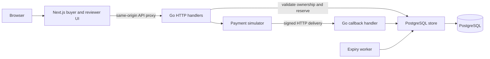
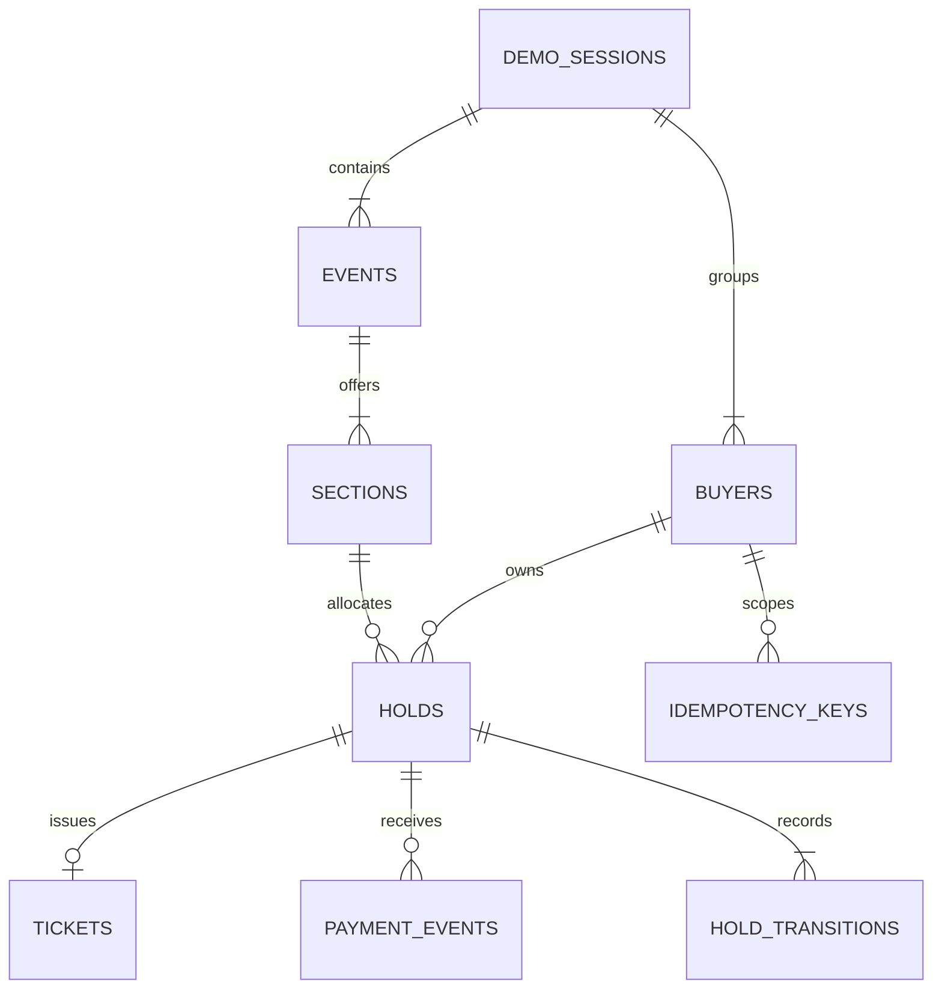
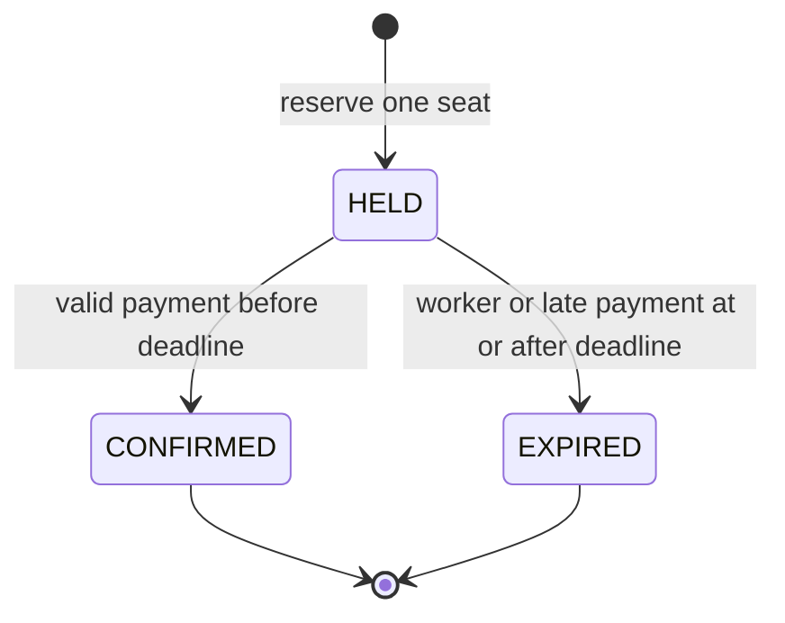

# How TribunPass reserves the last ticket

A section holds ten tickets. If a hundred buyers reserve one ticket each, exactly ten can obtain a hold. If the winning buyer loses the HTTP response, they can retry the original request. Their existing hold, its price and its deadline survive the retry. The database commits each business decision together with the evidence needed to recover it.

## Runtime architecture



Each Go process runs an HTTP server, an expiry loop and a bounded database connection pool. The only shared mutable state needed for booking is in PostgreSQL. A request can reach one instance, a retry another, and a worker on either can release a seat. Go contexts carry cancellation into database operations. At shutdown the process stops claiming work, drains HTTP requests for up to ten seconds, waits for the worker and closes the pool. [Process wiring](../cmd/tribunpass/main.go) · [Worker](../internal/expiry/worker.go)

The browser starts with a guest buyer credential and a private demo match. Only a hash of the random token is stored. The main event and scenario fixtures share a sandbox. Each scenario creates its own inventory so running the last-ticket race twice starts both runs with one available seat. The race releases two goroutines through the same start channel and calls the normal booking method for two distinct buyers. [Scenario runner](../internal/httpapi/scenarios.go) · [API contract](openapi.yaml)

## Persistent model



| Data | Constraint or access path | Why it matters |
| --- | --- | --- |
| Section inventory | `0 <= available <= capacity` | Every active or confirmed hold consumes one seat. |
| Hold | Three allowed states and a partial index on `(expires_at, id)` for `HELD` | The worker can find the oldest due hold without scanning historical bookings. |
| Price and time | Hold snapshots the integer IDR price and a five-minute database deadline | Retries and callbacks refer to the original terms of the reservation. |
| Idempotency | Primary key on `(buyer_id, operation, key)` | Two buyers can choose the same key independently. |
| Payment receipt | Primary key on `(provider, event_id)` | An exact redelivery can obtain the result of the first delivery. |
| Ticket and timeline | Unique `tickets.hold_id` and primary key on `(hold_id, sequence)` | One issued ticket and one ordered history per hold. |
| Buyer credential | Unique token hash on the buyer, linked to the sandbox | Multiple buyers can compete for the same section while only reading their own reservations. |

The service checks `available + HELD + CONFIRMED = capacity` in integration tests with one SQL snapshot. An overdue hold whose expiry transaction is still pending counts as `HELD`. Migrations run in a transaction under an advisory lock so two new instances can start together. The credential migration copies already-issued token hashes to their original buyers. [Initial schema](../migrations/001_initial.sql) · [Credential migration](../migrations/002_buyer_credentials.sql) · [Migration runner](../migrations/migrate.go)

## Reservation lifecycle



**Create a hold.** Verify that the buyer and section belong to the same sandbox. Claim the request key. The holder of a new key runs a conditional inventory update, snapshots the returned price, inserts the hold and writes the first timeline entry. The response is recorded in the same transaction. When the section has no inventory, the service commits the sold-out outcome under the same key. All SQL in the transaction uses the same `sql.Tx`. [CreateHold](../internal/postgres/holds.go)

```sql
UPDATE sections
SET available = available - 1
WHERE id = $1 AND available > 0
RETURNING price_idr;
```

**Accept a payment.** The buyer endpoint reads the price of the caller's hold and sends a signed callback over HTTP. It holds no database transaction open during delivery. The callback validates an HMAC-SHA256 of the original request bytes, accepts a supported event type, and claims the event ID. For a new event it acquires the hold lock, reads the current database time, and compares the amount with the hold's snapshot. [Simulator](../internal/simulator/simulator.go) · [Callback handler](../internal/httpapi/payments.go) · [Payment transaction](../internal/postgres/payments.go)

| Callback input and locked state | Persisted outcome and effect |
| --- | --- |
| Same event ID and payment fields | Replay the original receipt. |
| Same ID with changed hold or amount | Return `EVENT_CONFLICT`. The first receipt stays authoritative. |
| New event with a mismatched amount | Record `AMOUNT_MISMATCH`. Leave the hold eligible for a valid payment until its deadline. |
| Valid payment on a live hold | Record `CONFIRMED`. Issue one ticket and append the terminal transition. The seat was deducted at reservation time. |
| Valid payment on an overdue hold | Record `RECORDED_LATE`. Expire the hold, return its seat and append the terminal transition. |
| New event on a confirmed or expired hold | Record `ALREADY_CONFIRMED` with the existing ticket or `RECORDED_LATE` for an expired hold. |

**Release expired inventory.** At startup and each second the worker attempts up to 50 holds within a three-second batch deadline. Each transaction selects one due row ordered by deadline and ID with `FOR UPDATE SKIP LOCKED`. It rechecks the clock and uses the same terminal transition as the callback. A crash before commit rolls back the seat release and timeline entry together. The next worker can claim the row. Expired 24-hour sandboxes are deleted one at a time with dependent demo data. [Expiry transaction](../internal/postgres/payments.go) · [Cleanup](../internal/postgres/store.go)

## Architectural decisions

### ADR 1 — Claim idempotency keys inside the inventory transaction

**Problem.** A browser may time out after the database has committed. Purchase status is ambiguous to the caller. A concurrent retry might also arrive while the original transaction holds the last seat.

**Decision.** Use `READ COMMITTED` with a unique key claimed by `INSERT ... ON CONFLICT DO NOTHING`. The winning transaction commits inventory, the hold, its timeline and the response together. A competing insert may wait for the winner. The loser issues a separate `SELECT` after that wait so its new statement snapshot sees the committed result. It checks the normalized section ID and returns the stored result or an idempotency conflict. A rollback leaves the key available for a retry. [Store implementation](../internal/postgres/holds.go) · [PostgreSQL isolation](https://www.postgresql.org/docs/current/transaction-iso.html#XACT-READ-COMMITTED)

**Consequence.** A replay can still return the original `201 HELD` after the buyer pays. `GET /v1/holds/{id}` reads current state, ticket and timeline in a single statement. A buyer intending a fresh reservation after a sold-out response supplies a fresh key. Contending buyers serialize on inventory for their particular section. [Replay and concurrency tests](../internal/postgres/store_test.go)

### ADR 2 — Decide the deadline after acquiring the hold lock

**Problem.** An HTTP callback can arrive a millisecond before the deadline, then wait behind another transaction until the seat is due. Multiple API processes and workers must agree on the result.

**Decision.** Acquire the hold row with `FOR UPDATE`, then issue a separate `SELECT clock_timestamp()`. Only `dbNow.Before(expiresAt)` confirms a live reservation. Equality expires it. The price check, status transition, ticket or restock, receipt and history share a commit. A worker also takes the hold lock before finalizing a transition. [Pure decision function](../internal/booking/booking.go) · [Database clock semantics](https://www.postgresql.org/docs/current/functions-datetime.html#FUNCTIONS-DATETIME-CURRENT)

**Consequence.** Queueing for a lock can cause a payment submitted before the deadline to arrive too late for confirmation. A stalled worker can delay the return of unsold inventory. Payment eligibility still follows the database deadline during that delay. The lock-wait test explicitly observes a blocked callback in PostgreSQL, moves the deadline into the wait interval and verifies a single restock. [Expiry tests](../internal/postgres/expiry_test.go)

## Tracing a disputed booking

1. Read the hold and its timeline. A confirmed hold has one ticket. An expired hold has an expiry transition with cause `expiry_worker` or `payment_callback`.
2. Correlate `hold_id`, `event_id` and `request_id` with the structured Go logs. A repeated delivery logs its cached outcome and a replay flag. A request lost after commit is recoverable by retrying with its original key.
3. Read `/metrics` on the API. The oldest overdue age and due-hold count come from the database. Pool waits and request-outcome counters belong to each Go process. When investigating slow requests, compare pool waits, successful-reservation latency and sold-out latency separately. [Metrics implementation](../cmd/tribunpass/metrics.go)
